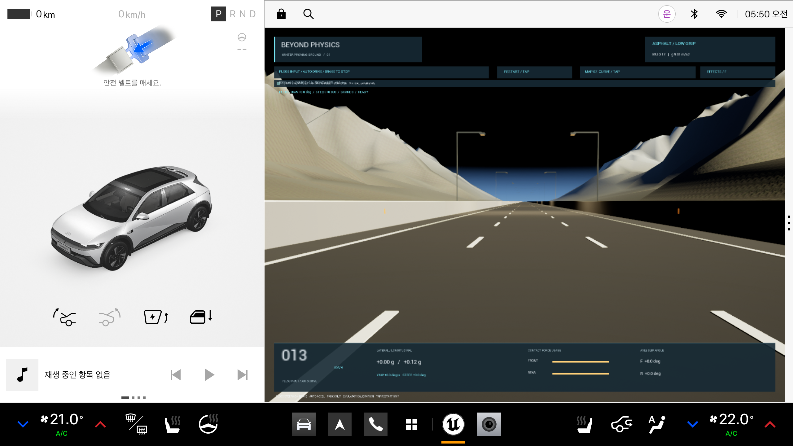
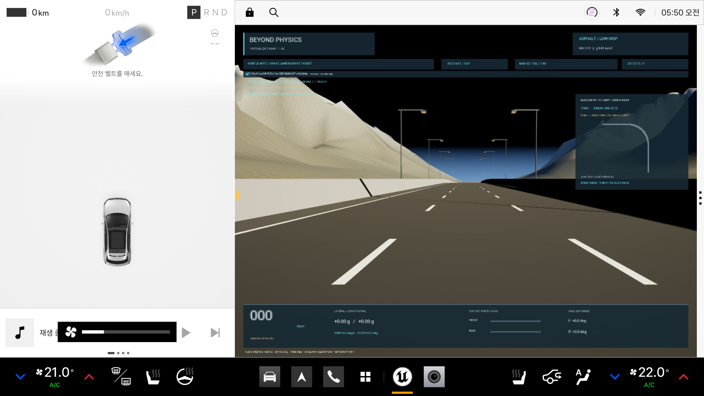
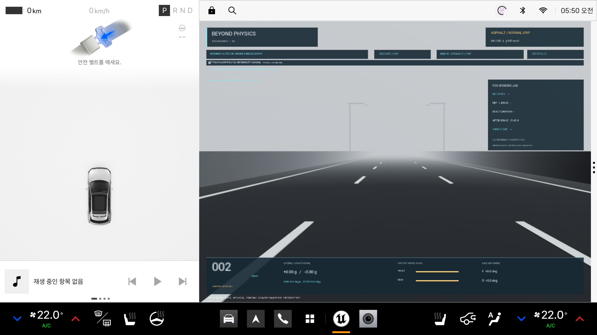
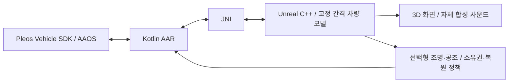

# BEYOND PHYSICS

**Pleos Connect의 조향·브레이크와 감각 피드백으로 마찰력과 시야의 한계를 체험하는 차량용 물리 시뮬레이터.**

공모전 제출용 프로토타입 v0.1.0. 하나의 Unreal APK에 세 맵을 담았다. 실제 차량은 정차 상태로 두고 가상 차량만 움직인다. 실차 사용을 승인받은 제품이나 운전 훈련 인증 도구가 아니다.

| 맵 | 물리 조건과 체험 |
|---|---|
|01 직선 얼음 도로|2km·3차로, μ=0.12, 정지 출발·자동 가속, 제동/조향과 벽 접촉|
|02 곡선 얼음 램프|μ=0.12, R150m 기반 가상 램프, 감속 후 진입과 시도별 궤적 비교|
|03 안개 고속도로|4km·3차로, 일반 건조 노면 대표값 μ=0.80, 80→100km/h, 시야 기준30m와 차로별 정지 차량|

곡선 도로는 공식 설계 기준을 참고한 **가상 도로**로 특정 실제 도로 도면을 복제하지 않았다. μ는 모델의 대표 조건이며 모든 실제 얼음/아스팔트의 실측값이라고 주장하지 않는다.

## APK 다운로드와 실행

APK는 이 저장소의 **Releases**에 별도 첨부한다. 업로더가 아래 줄을 실제 Release URL로 바꿔야 한다.

**APK 경로: Releases → v0.1.0-prototype → BEYOND_PHYSICS_release.apk (팀명에 맞춰 파일명 변경 가능)**

검증 환경: Windows / Unreal5.8 / Pleos Connect v2.1.0 / Android14 API34 / **x86_64**. SDK36·NDK27.2·JDK21로 빌드한다. ARM64 기기·실차·운전대 뒤 계기판은 검증하지 않았다. 화면은 Pleos 인포테인먼트 앱 영역이다.

1. Pleos 에뮬레이터를 켜고 Release APK를 설치한다.
2. `adb forward tcp:8088 tcp:8088` 후 http://127.0.0.1:8088/ 의 Virtual Console을 열어 둔다.
3. 콘솔은 **P / speed0 / accelerator0**. 게임을 열어 조향과 Brake로 조작한다. 가속은 자동이다. 브레이크 입력은 현재 SDK의 눌림 여부이며 압력 비례 제어가 아니다.
4. 화면의 **MAP**으로 맵 변경, **RESTART**로 재시작, **EFFECTS**로 조명·공조·사운드를 선택한다. 조명·공조는 기본 OFF, 소리는 ON이다.
5. P 해제/UX 제한/입력 단절/백그라운드에서 게임과 효과를 중단한다. 조건 회복 후 RESTART한다. 지원되지 않는 차량 기능은 적용된 것처럼 표시하지 않는다.

[설치·서명 충돌 해결·재빌드](docs/RELEASE_BUILD.ko.md) · [효과 설정과 복원](docs/MAP_FEEDBACK.ko.md) · [업로드 방법](docs/SUBMISSION_GITHUB.ko.md) · [APK 안내](apk/README.md)

이번 Shipping APK의 실제 검증: [결과](docs/RELEASE_VERIFICATION.ko.md).

## 구현

차량 운동은 별도 C++ 모델에서 계산하며 Unreal 차량 메시의 Chaos 차량 물리에 맡기지 않는다. 고정 간격 적분·슬립·마찰력 한계를 계산한다. 직선/램프는 기본 자전거 모델, 안개 맵은 4접촉점과 Ackermann·일반 승용차 조향비 모델이다. 실제 특정 차종 보정, 완전한 타이어 실측 모델, ABS/ESC, 서스펜션과 동적 하중이동은 구현 범위가 아니다.

- 물리 원본: `unreal/BeyondPhysics/Source/BeyondPhysics/Physics/`
- 입력/진행/카메라: `Source/BeyondPhysics/Driving/`
- 화면/감각: `Source/BeyondPhysics/UI/`, `Source/BeyondPhysics/Feedback/`
- 맵/그래픽: `unreal/BeyondPhysics/Content/Maps/`, `Content/Driving/`, `Content/Vehicles/`
- 차량 SDK/설정 복원: `android/pleosbridge/src/main/java/com/beyondphysics/pleos/`
- 출처/가정/실험 이력: `docs/engineering/` (날짜별 개발 이력을 포함하므로 최신 실행 안내는 이 README와 RELEASE_BUILD를 따른다.)

Pleos SDK는 조향/제동 읽기와 앰비언트 조명/공조 읽기·허용된 쓰기에 사용한다. 자체 오디오는 Android 오디오 포커스를 따르는 Unreal 사운드이며 Pleos TTS SDK 기능으로 표시하지 않는다. 실제 가속페달을 요구하지 않으며 구동계 분리 API를 사용하거나 차량 액추에이터를 우회 제어하지 않는다. 에뮬레이터 전용 제한을 유지한다.

## 빌드와 권리

[Release 빌드 안내](docs/RELEASE_BUILD.ko.md)의 명령으로 Release AAR와 Unreal Shipping/Distribution APK를 만든다. Unreal Editor에서 `unreal/BeyondPhysics/BeyondPhysics.uproject`를 열어 그래픽을 수정한다. Android Studio는 라이브러리 작업·AVD·APK 설치/로그 확인에 사용한다.

서명 키·비밀번호·엔진/플러그인 바이너리·SDK 추출 소스·캐시는 제공하지 않는다. 편집 보조용 MCP 플러그인은 공개 사본에서 필수가 아니다. [자산/라이선스 출처](THIRD_PARTY_NOTICES.md)와 [권리 안내](RIGHTS.md)를 확인한다. 외부 SDK/엔진은 각 제공자의 약관에 따라 별도 설치한다.
