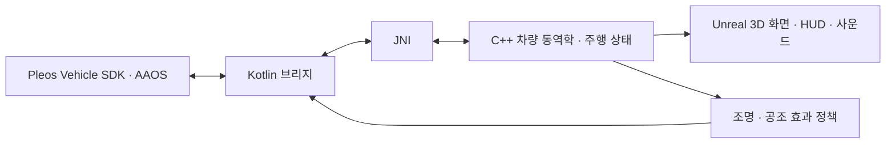

# BEYOND PHYSICS

**Pleos Connect의 차량 입력과 실내 감각 피드백으로 도로의 물리적 한계를 체험하는 드라이빙 시뮬레이터.**

BEYOND PHYSICS는 조향과 브레이크 조작을 가상 차량에 연결하고, 노면의 마찰력·도로의 곡률·운전자의 시야가 주행에 미치는 영향을 화면과 수치로 보여준다. 미끄러운 도로에서 제동하며 방향을 바꾸거나, 안개 속에서 정지 차량을 발견했을 때의 상황을 반복해서 비교할 수 있다.

차량의 움직임은 별도로 작성한 C++ 동역학 모델이 계산한다. Unreal Engine은 도로·차량·안개를 렌더링하고, Pleos Vehicle SDK는 차량 입력과 앰비언트 조명·공조를 연결한다.

| 항목 | 내용 |
|---|---|
|버전|v0.1.0 · Android Shipping Release|
|실행 환경|Pleos Connect Emulator v2.1.0 · Android 14 / API 34 · x86_64|
|표시 화면|Pleos 인포테인먼트 앱 영역|
|배포 파일|[GitHub Releases](https://github.com/sanghyeok1000/hyundai-project/releases) · `BEYOND_PHYSICS_release.apk`|
|실행 안내|[APK 설치와 조작](docs/RUNNING.ko.md)|
|소스 빌드|[빌드 환경과 절차](docs/RELEASE_BUILD.ko.md)|

## 기획 의도

빙판길에서는 속도를 줄이는 데 긴 거리가 필요하고, 커브에서는 제동과 선회가 타이어의 접지력을 함께 사용한다. 안개 속에서는 제동력이 충분해도 장애물을 발견한 뒤 남은 거리가 부족할 수 있다. 이런 차이는 실제 주행에서 위험을 감수하며 반복하기 어렵다.

이 프로젝트는 차량의 조작계와 실내 환경을 물리 현상을 경험하는 인터페이스로 활용한다. 같은 도로에서 제동 시점과 진입 속도를 바꾸고, 그 결과를 주행 궤적·가속도·접지력 사용량으로 확인하도록 구성했다. 현재 프로토타입은 정차 상태의 차량 신호를 공급하는 Pleos 에뮬레이터에서 실행한다.

## 세 가지 주행 실험

하나의 APK에서 화면 상단 **MAP** 버튼으로 맵을 전환한다. 기본 시점은 차량 앞쪽에서 도로를 보는 1인칭 시점이다.

### 01. 직선 얼음 도로

2km 길이의 3차로 도로다. 마찰계수는 **μ=0.12**이며 정지 상태에서 자동으로 가속한다. 브레이크를 누르면 구동 요청이 끊기고 제동력이 발생한다. 브레이크를 놓으면 다시 가속한다.

직선에서 제동한 결과와 조향을 함께 사용한 결과를 비교한다. 화면 아래의 앞·뒤 접지력 사용량과 슬립각을 보면 타이어가 힘을 전달하는 상태를 확인할 수 있다. 양옆 벽에 닿으면 주행이 멈추고 **RESTART**로 다시 시작한다.


### 02. 곡선 얼음 램프

반경 **150m**의 우회전 곡선을 중심으로 완화구간·내리막·편경사를 구성한 가상 진출 램프다. 직선 맵과 같은 **μ=0.12**를 사용한다. 전체 길이는 약 **636m**, 최대 내리막은 **3%**, 최대 편경사는 **4%**다.

이 맵은 완만하게 자동 가속한다. 제동 후에는 낮아진 속도를 기준으로 가속 목표가 조정되므로, 곡선에 진입하기 전에 속도를 줄여 주행을 이어갈 수 있다. 내려가는 경사에서도 차량에 작용하는 중력을 계산한다.

오른쪽 패널에서 이번 시도와 직전 시도의 **곡선 진입 속도·주행 궤적·도로 중심에서 벗어난 거리**를 비교한다. 제동 시점을 앞당겼을 때 곡선을 통과하는 경로가 어떻게 바뀌는지 확인하는 맵이다.


### 03. 안개 고속도로

4km 길이의 3차로 도로에 안개 구간과 차로별 정지 차량을 배치했다. 노면은 **μ=0.80**인 건조 아스팔트 조건이다. 차량은 **80km/h**로 시작해 **100km/h**를 향해 가속하며, 첫 제동 이후 자동 가속이 해제된다.

정지 차량은 서로 다른 위치에 한 대씩 배치돼 있다. 안개에 들어가기 전에 감속한 경우와 차량을 발견한 뒤 제동한 경우를 비교한다. 결과 패널은 **기준 지점의 속도, 기준 지점부터 제동까지의 시간·이동 거리, 첫 제동 이후의 거리, 앞차와의 간격**을 표시한다.

분석 기준 거리는 앞차까지 **30m**다. 이 기준에 도달하기 전에 제동한 시도는 예방 제동으로 구분한다. 100km/h·μ=0.80에서 이상적인 직선 제동거리만 약 **49.2m**이므로, 시야가 확보된 거리와 정지에 필요한 거리를 함께 비교할 수 있다.


## Pleos 연동 기능

| 기능 | 앱에서 사용하는 방식 |
|---|---|
|조향 입력|Vehicle SDK의 조향 값을 가상 차량의 전륜 조향에 연결한다.|
|브레이크 입력|브레이크 눌림 상태를 읽어 가상 차량의 제동 요청으로 사용한다.|
|주차·주행 제한|AAOS의 P 상태와 UX 제한을 확인해 실행을 제한한다. 신호가 끊겨도 주행을 중단한다.|
|앰비언트 조명|얼음 맵은 접지력 사용과 슬립에 따라 청록색에서 호박색으로 변한다. 안개 맵은 시야 기준 안의 앞차에 반응한다.|
|공조|얼음 맵은 약한 풍량과 냉감을, 안개 맵은 낮은 풍량을 적용한다.|
|사운드|가상 구동음·노면음·풍절음·슬립음·앞차 알림·접촉음을 주행 상태에 맞춰 합성한다.|
|설정 복원|효과 중단·맵 전환·주차 해제·앱 이탈 때 앱이 변경한 차량 설정을 복원한다. 수동으로 바꾼 설정은 우선한다.|

조명과 공조는 **EFFECTS**에서 각각 선택하며 처음 실행할 때는 꺼져 있다. 사운드는 켜져 있다. 공조는 기존 전원·에어컨·AUTO 설정과 기능 지원 상태를 확인해 적용한다. 조명 밝기는 지원 최댓값의 20% 이내로 제한한다. 소리는 Unreal에서 재생하며 Android 오디오 포커스를 따른다.

## 설치하고 실행하기

APK 실행에는 Unreal Engine이나 C++ 빌드 도구가 필요하지 않다. **Pleos 에뮬레이터와 Android SDK Platform-Tools의 adb**를 준비한다. 에뮬레이터 설치는 [Pleos 공식 설치 안내](https://document.pleos.ai/docs/connect/guide/getting-started/application-development/setup-connect-sdk-emulator)를 따른다.

### 1. APK 설치

[Releases](https://github.com/sanghyeok1000/hyundai-project/releases)에서 `BEYOND_PHYSICS_release.apk`를 내려받는다. Android Studio의 **Device Manager**에서 Pleos Connect v2.1.0을 시작한다. APK가 있는 폴더에서 PowerShell을 열고 다음을 실행한다.

```powershell
$adb = Join-Path $env:LOCALAPPDATA 'Android\Sdk\platform-tools\adb.exe'
& $adb devices
& $adb install -r '.\BEYOND_PHYSICS_release.apk'
& $adb forward tcp:8088 tcp:8088
```

기본 Android SDK 설치 경로를 사용하는 명령이다. 기기가 한 대만 연결된 상태에서 실행한다. 설치 충돌이나 여러 기기가 연결된 경우의 처리는 [실행 안내](docs/RUNNING.ko.md#문제-해결)에 정리했다.

### 2. 가상 차량 상태 설정

브라우저에서 **http://127.0.0.1:8088/** 을 열고 다음과 같이 설정한다. 이 브라우저 연결을 유지해야 가상 차량 신호가 공급된다.

| Virtual Console 항목 | 설정 |
|---|---|
|기어|P|
|실제 차량 속도|0km/h|
|Accelerator|0|
|Brake|해제|
|Steering|중앙|

콘솔의 차량은 정차 상태로 유지한다. 게임 안의 속도는 시뮬레이터가 별도로 계산하므로, 안개 맵에서 게임 속도가 100km/h여도 콘솔 속도는 0km/h다.

### 3. 게임 시작과 조작

```powershell
& $adb shell am start -n com.beyondphysics.simulator/com.epicgames.unreal.SplashActivity
```

게임이 열리면 Virtual Console의 **Steering**으로 조향하고 **BRAKE를 누르고 있는 동안** 제동한다. 가속은 맵별 자동 가속 정책이 처리한다. 시작 화면에 입력 대기나 재시작 안내가 남으면 콘솔 연결과 P 상태를 확인하고 **RESTART**를 누른다.

| 게임 화면 버튼 | 동작 |
|---|---|
|MAP|직선 → 곡선 → 안개 순서로 맵 전환|
|RESTART|현재 맵의 새로운 시도 시작|
|EFFECTS|주행을 멈추고 조명·공조·사운드 설정 열기|
|APPLY AND RESTART|효과 설정을 적용하고 현재 맵 재시작|

효과를 확인하려면 **EFFECTS → AMBIENT LIGHT / GENTLE CLIMATE → APPLY AND RESTART** 순서로 선택한다. 조명과 공조의 실제 값은 Virtual Console에서도 확인할 수 있다. 효과 상태의 `APPLIED`는 SDK 읽기 결과로 적용을 확인한 상태다.

## 화면에서 확인할 수 있는 값

- **KM/H**: 가상 차량의 속도.
- **LATERAL / LONGITUDINAL**: 차체 기준 횡·종가속도.
- **YAW / STEER**: 요레이트와 전륜 조향각.
- **CONTACT FORCE USAGE**: 앞·뒤 타이어의 마찰력 한도 사용량.
- **AXLE SLIP ANGLE**: 앞·뒤 차축의 슬립각.
- **맵별 결과 패널**: 램프의 진입 속도·궤적 비교, 안개 맵의 제동 시점·이동 거리·정지 결과.

## 물리 계산과 소프트웨어 구조

질량·요 관성·무게중심 위치를 가진 차량의 종·횡운동과 요 운동을 계산한다. 타이어 힘은 현재 차체 속도와 접지점 속도에서 구하며, 제동력과 횡력이 같은 마찰력 한도를 공유한다. 안개 맵은 네 바퀴의 접지점과 Ackermann 조향 기하를 사용한다. 직선·램프 맵은 앞·뒤 차축을 묶은 자전거 모델을 사용한다.

외부 고정 시간 간격은 **1/240초**이며, 내부에서는 **0.5ms 이하의 RK4 적분**으로 상태를 갱신한다. 계산 결과를 차량 위치·방향·바퀴 표시와 HUD에 공통으로 사용한다. 램프는 노면 경사에 따른 중력 성분과 수직하중을 반영한다.



| 위치 | 역할 |
|---|---|
|[`Physics/`](unreal/BeyondPhysics/Source/BeyondPhysics/Physics)|차량 동역학, 타이어 힘, 조향 기하, 도로 형상|
|[`Driving/`](unreal/BeyondPhysics/Source/BeyondPhysics/Driving)|입력, 자동 가속, 고정 시간 실행, 카메라, 주행 상태|
|[`Experiment/`](unreal/BeyondPhysics/Source/BeyondPhysics/Experiment)|램프 시도 비교와 안개 제동 결과|
|[`Feedback/`](unreal/BeyondPhysics/Source/BeyondPhysics/Feedback)|맵별 감각 효과 정책과 합성 사운드|
|[`UI/`](unreal/BeyondPhysics/Source/BeyondPhysics/UI)|HUD, 결과 패널, 효과 설정|
|[`Content/`](unreal/BeyondPhysics/Content)|맵, 차량, 도로, 산, 재질, 텍스처|
|[`android/pleosbridge/`](android/pleosbridge)|Vehicle SDK, AAOS 실행 제한, 장치 설정 복원|

물리 방정식·파라미터·분석해 비교는 [차량 물리 모델](docs/engineering/PHYSICS_MODELS.md), SDK 함수와 권한은 [Pleos API 구성](docs/engineering/API_CAPABILITIES.md)에 정리했다.

## 구현 및 검증 범위

Release APK의 설치·서명·파일 정렬·디버깅 비활성화와 세 맵의 SDK 입력·효과 적용·설정 복원·주차 해제 시 중단을 확인했다. 상세 결과와 APK SHA256은 [Release 검증](docs/RELEASE_VERIFICATION.ko.md)에 있다. 수치 계산의 검증 코드도 [`Tests/`](unreal/BeyondPhysics/Tests)와 [Kotlin 단위 검사](android/pleosbridge/src/test/java/com/beyondphysics/pleos)에 포함했다.

현재 배포 대상은 **x86_64 Pleos 에뮬레이터**다. 실차 ARM64와 운전대 뒤 계기판은 후속 연동 대상이다. 차량 물리는 일반 승용차의 평면 운동 모델이며 서스펜션·동적 하중 이동·ABS/ESC는 모델에 포함하지 않는다.

## 상세 문서

- [APK 설치·조작·문제 해결](docs/RUNNING.ko.md)
- [소스 빌드와 Unreal 편집](docs/RELEASE_BUILD.ko.md)
- [맵별 조명·공조·사운드](docs/MAP_FEEDBACK.ko.md)
- [램프 형상](docs/VIRTUAL_RAMP.ko.md) · [램프 속도 관리와 비교](docs/RAMP_LEARNING.ko.md)
- [안개 시나리오](docs/FOG_HIGHWAY.ko.md) · [4접촉점 조향 모델](docs/FOG_FEEDBACK_PHYSICS.ko.md)
- [공개 파일 구성](docs/REPOSITORY_CONTENTS.ko.md)
- [자산 출처](THIRD_PARTY_NOTICES.md) · [권리 안내](RIGHTS.md)
